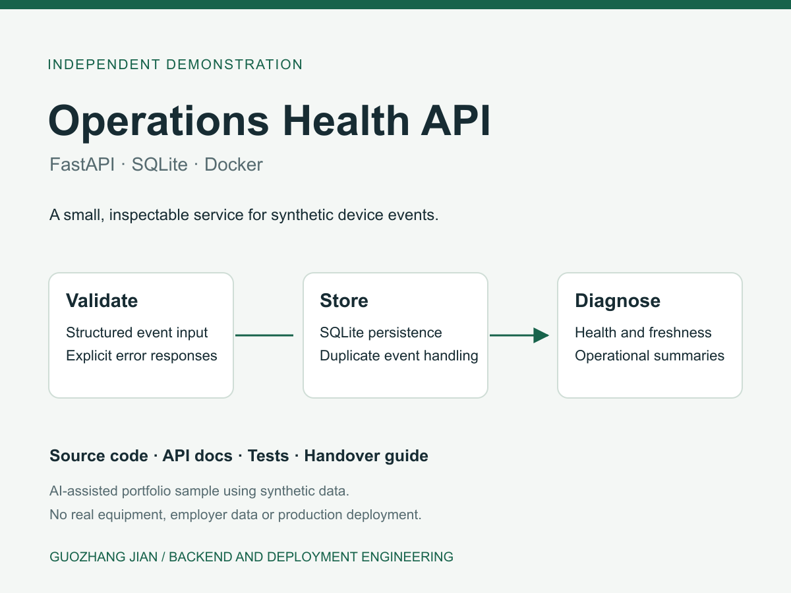
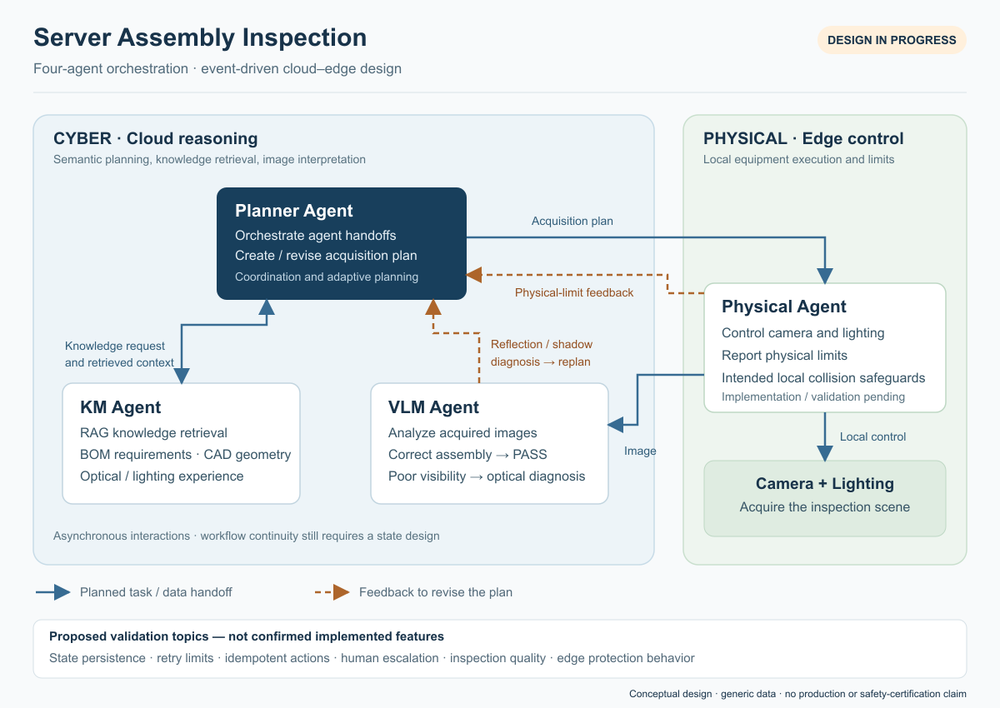

# Guozhang Jian | Engineering Portfolio

Python APIs, deployment diagnostics, and AI workflow architecture.

My background is in manufacturing AI and edge software: building FastAPI and React tools, integrating equipment APIs, supporting containerized deployments, and coordinating development and operations work. This repository gives reviewers two different kinds of evidence: an executable backend demonstration and an architecture case study for an ongoing multi-agent project.

## Selected work

| Project | Evidence | Status |
| --- | --- | --- |
| [Operations Health API](projects/operations-health-api/) | Python source, SQLite persistence, automated tests, HTTP walkthrough, Docker configuration | Local Python execution verified; container verification is tracked separately |
| [Server Assembly Inspection](case-studies/server-assembly-inspection/) | Four-agent responsibilities, cloud/edge boundaries, optical feedback loop, design tradeoffs | Architecture and workflow design in progress |

### Operations Health API



A small FastAPI service receives synthetic device events and turns them into inspectable operational history and diagnostics. It is designed to make common integration decisions easy to review:

- An explicit input contract with bounded fields and timezone-aware timestamps.
- Idempotent event retries, including concurrent requests and conflicting key reuse.
- Persistent SQLite history, filtered pagination, and handling of late-arriving events.
- Separate liveness and storage-readiness checks.
- Freshness, missing-data, clock-skew, and device-attention diagnostics.
- Local-only Docker Compose configuration and a practical handover guide.

The recorded local run passed **15 integration tests** and **11 live HTTP scenarios**. The [verification record](projects/operations-health-api/evidence/verification.json) identifies what was executed and what was not. The [CI workflow](.github/workflows/verify.yml) runs the tests and separately builds and exercises the container; its result must be checked before claiming container verification.

[Read the implementation guide](projects/operations-health-api/README.md) · [Read the case study](case-studies/operations-health-api.pdf) · [Inspect the API screenshot](assets/operations-health-api-docs.jpg)

### Server Assembly Inspection



I lead the overall architecture and agent workflow design for this in-progress project. The design coordinates a **Planner**, **KM/RAG**, **Physical**, and **VLM** agent, keeping cloud reasoning separate from edge camera and lighting control. Optical diagnoses such as reflection or shadow feed back into replanning and another capture.

The case study explains responsibilities, boundaries, proposed message contracts, and validation work still required. It does not claim a completed four-agent implementation, production deployment, measured inspection accuracy, or validated equipment safety.

[Read the architecture case study](case-studies/server-assembly-inspection/) · [Download the PDF](case-studies/server-assembly-inspection.pdf) · [Open the editable diagram](case-studies/server-assembly-inspection/server-assembly-inspection-architecture.svg)

## Run the API locally

From this repository's root:

```sh
cd projects/operations-health-api
python3 -m venv .venv
.venv/bin/python -m pip install -r requirements-lock.txt
.venv/bin/python -m pytest -q
.venv/bin/python -m uvicorn app.main:app --host 127.0.0.1 --port 8765
```

Open `http://127.0.0.1:8765/docs`. In another terminal, from the same project directory:

```sh
.venv/bin/python scripts/walkthrough.py http://127.0.0.1:8765
```

Python 3.12 was used for the recorded verification. The service runs locally without an LLM account, paid API, or real equipment. For Docker instructions, API behavior, and known limitations, see the [project README](projects/operations-health-api/README.md).

## Scope and provenance

The API is a newly prepared, **AI-assisted independent demonstration using synthetic data**. It is not a previous employer or customer deliverable. The architecture case study describes my stated design responsibility, with illustrative interfaces and unvalidated considerations labeled explicitly. No employer source code, BOM/CAD files, internal topology, or production data is included.

## Collaboration

Available for ongoing part-time collaboration of **10–20 hours per week**, based in Taiwan, Asia/Taipei time zone. Suitable starting scopes include a FastAPI integration, a deployment issue with a clear reproduction, or a bounded architecture and workflow review.

[Upwork profile](https://www.upwork.com/freelancers/~0155077a40b1d8cf35) · [中文導覽](README.zh-TW.md)
