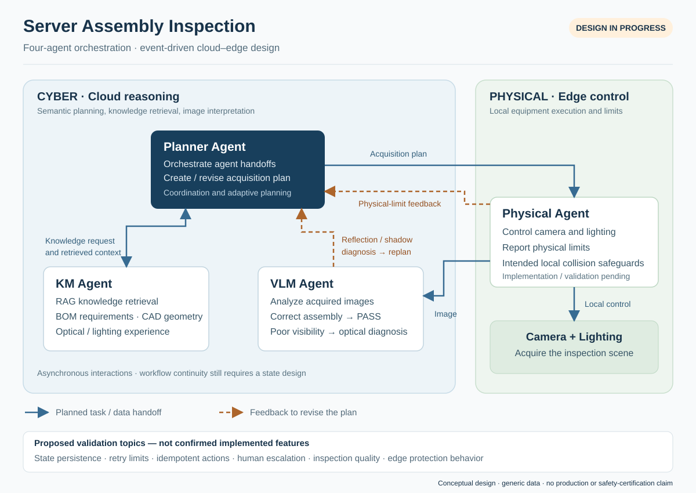

# Server Assembly Inspection
## Four-Agent Architecture for Adaptive Visual Inspection

**Status:** In progress · architecture and workflow design  
**My role:** Lead for overall system architecture and agent workflow design  
**Focus:** Multi-agent orchestration, cloud–edge separation, knowledge retrieval, and visual feedback

This project explores how specialized AI agents can coordinate a server assembly inspection workflow. I lead the overall architecture and agent workflow design: defining responsibilities, separating cloud reasoning from physical execution, and designing the feedback loop between image analysis and camera/lighting adjustments.

The case study presents the current design. It does not claim completed agent implementation, production deployment, validated inspection accuracy, or certified physical safety. The diagram and message examples use generic concepts rather than employer data, drawings, or hardware specifications.

### The problem

Visual inspection depends on both the assembly and the quality of the image. Reflection or shadow can hide a component even when the camera captures the intended scene. A useful inspection workflow must distinguish a usable observation from an image that needs another acquisition attempt.

The design connects assembly knowledge, scene control, and visual reasoning through a coordinating Planner. Instead of treating every unclear image as an assembly decision, the system can return an optical diagnosis to the planning stage and adjust the acquisition plan.

### Design goals

- Give each agent a specific responsibility and a clear handoff.
- Keep semantic reasoning and knowledge retrieval in the cloud, while retaining equipment control and intended local protection at the edge.
- Make inadequate visibility actionable through feedback about reflection, shadow, or scene limitations.
- Support asynchronous, event-driven coordination without requiring one cloud process to remain active throughout a physical inspection cycle.

### Architecture and responsibilities



| Agent | Design responsibility | Boundary |
|---|---|---|
| **Planner Agent** | Orchestrate the workflow, use retrieved knowledge, and create or revise the hardware-control plan. | Owns coordination; does not directly bypass edge equipment control. |
| **KM Agent** | Retrieve model-specific BOM requirements, CAD geometry, and historical optical/lighting knowledge through a RAG knowledge layer. | Supplies relevant knowledge; does not make the physical movement decision. |
| **Physical Agent** | Receive a plan at the edge and drive the camera and lighting. Include intended local collision safeguards, report physical limits, and support scene adjustment. | Local control must enforce its own limits; protection behavior still requires implementation and validation. |
| **VLM Agent** | Analyze acquired images. Return PASS when the assembly is judged correct, or provide an optical diagnosis when reflection or shadow prevents a usable observation. | A poor observation triggers replanning; completed validation of decision quality is not claimed. |

### Normal inspection and optical feedback

1. **Plan:** The Planner determines the inspection task and requests relevant assembly and optical knowledge from KM.
2. **Acquire:** The Planner sends a hardware-control plan to the Physical Agent. The edge executes permitted camera/lighting actions within its intended local control boundary and returns the acquisition result or a physical-limit report.
3. **Interpret:** The VLM analyzes the acquired image. The supplied design includes PASS for correctly assembled items.
4. **Adapt when visibility is inadequate:** The VLM describes the optical issue and returns it to the Planner. The Planner revises the acquisition plan; the Physical Agent applies the permitted adjustment and captures another image.

The optical feedback path is the key orchestration feature: an observation problem changes the next acquisition action. It is not evidence that the hardware, inspection decisions, or adjustment policy have already been validated.

### Proposed message contracts

The following contracts are **illustrative design proposals**, not implemented interfaces. Identifiers, values, and the example event are synthetic.

| Handoff | Example information |
|---|---|
| Planner → KM | Inspection task reference, generic model reference, knowledge question |
| Planner → Physical | Inspection reference, proposed acquisition plan, scene/lighting request |
| Physical → workflow | Acquisition reference, image reference, execution status or reported limit |
| VLM → Planner | Acquisition reference, observation status, optical diagnosis, suggested adjustment |

```json
{
  "event_type": "optical_observation_inadequate",
  "inspection_id": "synthetic-demo-001",
  "acquisition_id": "synthetic-capture-02",
  "diagnosis": "Reflection obscures the target region",
  "suggested_adjustment": "Change lighting before reacquiring"
}
```

An optical suggestion is an input to planning. It is not an unrestricted command to physical equipment.

### Design decisions and tradeoffs

**Cloud reasoning, edge execution.** The architecture separates knowledge-intensive reasoning from local equipment control. This creates a clear responsibility boundary, while introducing communication delays and connectivity conditions that must be addressed during validation.

**Specialized agents, explicit coordination.** Separate KM, Physical, and VLM responsibilities make the handoffs easier to inspect. They also create more interfaces and context transfers than a single-process workflow. The Planner must preserve the relationship between the task, acquisition, and interpretation.

**Event-driven, with continuity to resolve.** Asynchronous interactions fit the design's serverless intent. A stateless cloud invocation does not eliminate workflow state: where inspection progress, pending actions, and evidence should persist remains an implementation decision.

**Adaptive imaging, bounded execution to define.** Optical feedback can improve the observation opportunity, but repeated adjustments can consume time without resolving the image. Retry limits, duplicate-event handling, idempotent physical actions, and human escalation are proposed engineering considerations, not confirmed implemented features.

### Next validation work

The next phase should establish evidence for both workflow behavior and practical limitations:

- Walk through normal inspection, optical ambiguity, and physical-limit scenarios using synthetic inputs and permitted test scenes.
- Validate whether optical diagnoses lead to useful adjustments; record the number of acquisition attempts and elapsed time.
- Define decision handling for visible assembly defects, unresolved ambiguity, and conflicting knowledge before operational use.
- Evaluate inspection decisions against reviewed examples, including false PASS outcomes and uncertainty, rather than reporting an unmeasured accuracy figure.
- Test intended edge protections with the actual equipment and qualified owners; document limits and failure behavior.
- Choose and test persistence, event correlation, retry boundaries, duplicate-event handling, and escalation behavior.

**Contribution demonstrated:** Leading the decomposition of a physical inspection problem into agent responsibilities, a cloud–edge control boundary, and a feedback-driven orchestration workflow. Runtime performance and production outcomes remain to be established.
